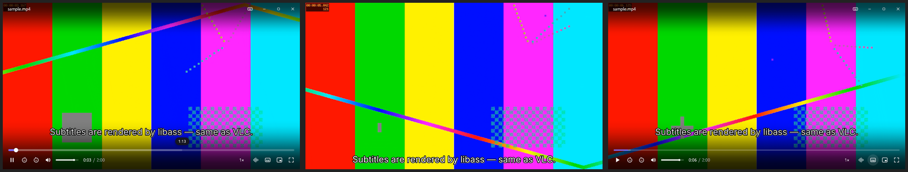

# Lumen



A minimal, modern video player for Windows, written in Rust.

Playback runs on **libmpv**, which is built on the same libraries as VLC:
**FFmpeg** for demuxing and decoding, and **libass** for styled ASS/SSA/SRT
subtitles. The UI is drawn with egui into the same OpenGL surface as the video.
That lets the controls blend over the picture as translucent gradients instead
of sitting in a separate toolbar.

## Design

- **Borderless window.** The title bar and controls are black-to-transparent
  gradients that float over the video.
- **Auto-hiding chrome.** The controls fade out after about 2 s without mouse
  movement, or as soon as the cursor leaves the window. What's left is a clean
  floating video, ready to use as picture-in-picture.
- **PiP mode** (`P`): shrinks the window to 400 px wide, keeps it always on
  top, and docks it to the bottom-right corner of the screen. Press `P` again to
  restore the previous size and position.
- **Aspect-locked resizing** on Windows, so the window always fits the video
  with no black bars. Drag anywhere to move the window and drag the edges to
  resize it.
- **Responsive controls.** Less important buttons drop away as the window gets
  smaller.
- **Subtitles move up** while the control bar is visible, so they never collide
  with it.
- Windows 11 rounded corners, dark frame, and Segoe UI.

## Features

- Opens anything FFmpeg can play. Hardware decoding is on (`hwdec=auto-safe`).
- Subtitles: picks up embedded and side-by-side subtitle files automatically.
  You can also drag in or browse for `.srt/.ass/.vtt/...` files, and change the
  subtitle size and delay from the subtitles menu.
- Audio track and subtitle track menus, a playback speed menu, chapter marks on
  the seek bar, and a hover timestamp while scrubbing.
- Playlists: drop several files at once, then use PgUp/PgDn.
- Remembers where you stopped in each file and resumes from there. Volume and
  subtitle size persist between sessions.
- Paste a file path or a URL with Ctrl+V. URLs work for anything
  yt-dlp supports, if `yt-dlp` is on your `PATH`.

## Build and run on Windows

1. Install Rust with the MSVC toolchain: <https://rustup.rs>.
2. Fetch libmpv. This script copies `libmpv-2.dll` into `target\debug` and
   `target\release`:
   ```powershell
   powershell -ExecutionPolicy Bypass -File scripts\fetch-libmpv.ps1
   ```
   Or do it by hand: download `mpv-dev-x86_64-*.7z` from
   <https://github.com/shinchiro/mpv-winbuild-cmake/releases>, then put
   `libmpv-2.dll` next to `lumen.exe`.
3. Run it:
   ```powershell
   cargo run --release -- "C:\path\to\movie.mkv"
   ```

libmpv is loaded at runtime, so building needs no import libraries and no
pkg-config. If the DLL is missing, Lumen shows a screen that names the file it
needs.

Release builds have no console window. To see mpv's log, run a debug build
(`cargo run`) or set `LUMEN_MPV_LOG=all=v`.

## Linux

Install `libmpv-dev`, or just `libmpv2`, then run `cargo run -- video.mp4`.

## Keyboard shortcuts

| Key | Action |
| --- | --- |
| Space / K, click video | Play / pause |
| ← / → | Seek 5 s (Shift: 1 s) |
| J / L | Seek 10 s |
| 0 – 9 | Jump to 0 % – 90 % |
| , / . | Previous / next frame |
| ↑ / ↓, mouse wheel | Volume |
| M | Mute |
| S / A | Cycle subtitles / audio track |
| Z / X | Subtitle delay −/+ 0.1 s |
| [ / ] / Backspace | Speed down / up / reset |
| F, double-click | Fullscreen |
| P | Picture-in-picture |
| PgUp / PgDn | Previous / next in playlist |
| Ctrl+O / Ctrl+V | Open file / paste path or URL |
| F1 | Shortcut overlay |
| Esc | Leave fullscreen or PiP |

## Code layout

| File | Purpose |
| --- | --- |
| `src/mpv.rs` | Runtime-loaded libmpv bindings: client API and OpenGL render API |
| `src/player.rs` | Mirrors mpv's properties (time, tracks, chapters…) and wraps its commands |
| `src/app.rs` | Window behavior, auto-hide logic, PiP, menus, input handling |
| `src/ui/` | Vector icons, theme, custom widgets (seek bar, sliders, menus) |
| `src/platform.rs` | Windows: DWM rounded corners, aspect-locked resizing, work-area lookup |

## Known limitations

- Windows 11 Snap Layouts don't appear when hovering the custom maximize
  button. Win+Z and drag-to-edge snapping still work.
- Video goes through OpenGL. On Windows that means mpv's `dxva2`/`nvdec`
  interop, or `*-copy` hardware decoding. Rendering straight through D3D11 would
  need mpv's (still experimental) D3D11 render API or a wgpu backend.
- There are no file associations or installer yet. You can still drag files onto
  `lumen.exe` or use "Open with".
